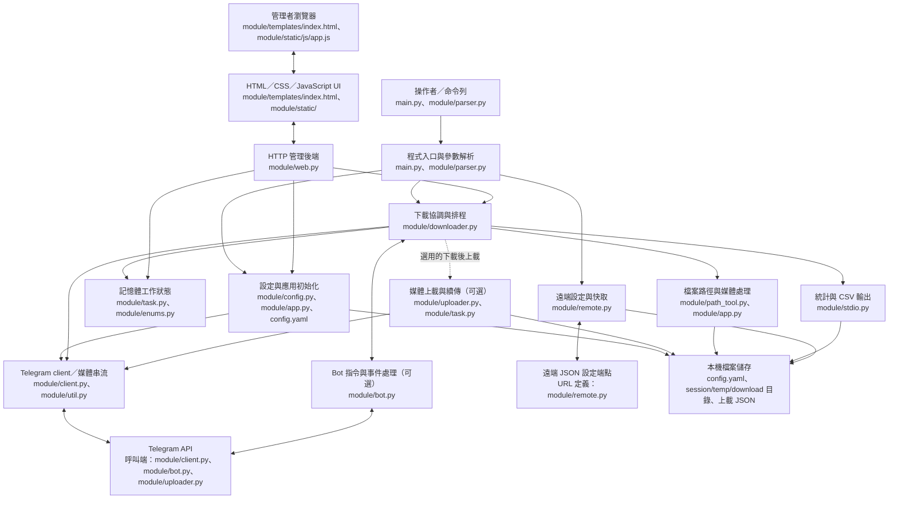
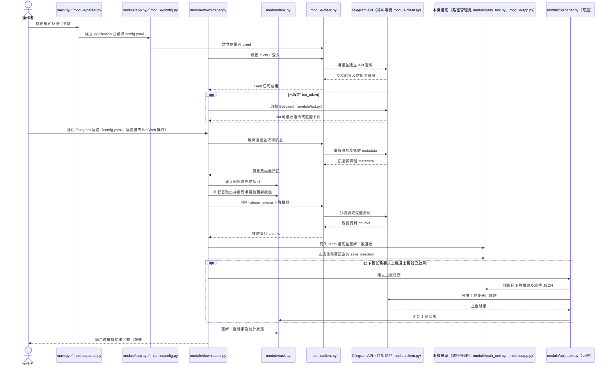

# 系統架構總覽 (Architecture Overview)

此 repository 實作 Telegram Restricted Media Downloader (TRMD)：以 Telegram 使用者帳號取得 Telegram 訊息媒體，並支援佇列下載、可選的 Telegram Bot 操作、媒體上載及 Web 管理面板。系統採用單一程序、模組化單體架構，而非 Microservices；`asyncio` 主事件迴圈負責工作協調，另以背景執行緒提供 HTTP 管理介面。主要技術包括 Python（`pyproject.toml` 宣告 `>=3.13.2`）、Kurigram、Rich、PyYAML、PyMediaInfo、TgCrypto，以及原生 HTML/CSS/JavaScript 前端；Docker 與 Nuitka 建置入口分別見 `Dockerfile`、`docker-compose.yml`、`build.py`。

## 核心程式元件 (Core Components)

- **命令列入口與參數解析** (`main.py`, `module/parser.py`): 解析 config、session、temp、Web host/port 等啟動參數，建立並執行下載器。
- **設定與應用程式初始化** (`module/config.py`, `module/app.py`, `config.yaml`): 載入本機 YAML 設定、解析目錄與並行限制，建立 Telegram 使用者 client，並提供媒體檔名、路徑與型別處理。
- **下載協調器** (`module/downloader.py`): 管理主流程、連結解析、下載工作排程、重試、暫停/取消、完成處理，以及 Bot/Web 管理操作的入口。
- **Telegram Bot 指令與互動** (`module/bot.py`, `module/downloader.py`): 在設定 `bot_token` 時註冊 Bot 指令、回呼與監聽/轉發功能，並為 Bot 操作委派下載器或上載器工作。
- **工作佇列與執行狀態** (`module/task.py`, `module/enums.py`): 以記憶體中的 `DownloadTask`、`UploadTask` 與狀態列舉維護待處理項目、進度、重試與控制狀態；上載分塊續傳資訊另以本機 JSON 檔案保存。
- **Telegram client 與媒體串流** (`module/client.py`, `module/util.py`): 擴充 Kurigram client 的授權、訊息/連結處理與媒體串流，供下載器從 Telegram API 讀取內容。
- **媒體上載器** (`module/uploader.py`): 在 Bot 功能可用時排程媒體上載、分塊傳輸、重試及續傳，並可由下載完成後的選用流程呼叫。
- **Web 管理後端** (`module/web.py`): 以 Python 標準函式庫 `ThreadingHTTPServer` 提供本機 HTTP 頁面與 API；負責狀態快照、設定管理、任務控制及呼叫下載器事件迴圈。
- **Web 管理前端** (`module/templates/index.html`, `module/static/js/app.js`, `module/static/css/style.css`, `module/static/css/admin.css`): 顯示下載/上載狀態、監聽及管理介面，並透過 HTTP API 查詢狀態或提交操作。
- **路徑與媒體檔案工具** (`module/path_tool.py`, `module/app.py`): 提供檔名處理、路徑/檔案操作及下載媒體的本機保存支援。
- **統計與輸出** (`module/stdio.py`): 顯示終端機進度、下載/上載統計表，並依設定輸出 CSV 報表。
- **遠端設定與快取** (`module/remote.py`): 取得、驗證並快取遠端 JSON 設定；設定資料及遠端位置由該模組定義。
- **共用基礎設施** (`module/__init__.py`, `module/language.py`): 初始化 logging、Rich console、全域常數與本地化文字。
- **封裝與部署** (`Dockerfile`, `docker-compose.yml`, `build.py`, `.github/workflows/`): 提供 Docker 執行設定、Nuitka standalone 建置流程與 Linux/Windows/Docker 發佈工作流程。

## 應用元件圖 (Application Component Diagram)

## 核心執行流程圖 (Flow Diagram)

> **資料持久化界線：** repository 未包含供下載任務或統計資料使用的業務資料庫 schema 或 migration；下載/上載工作狀態主要存在程序記憶體中（`module/task.py`）。設定以 YAML 保存（`module/config.py`、`config.yaml`），上載續傳資訊以 JSON 保存（`module/task.py`、`module/uploader.py`），Telegram session 檔案由 Kurigram client 管理（`module/app.py`、`module/client.py`）。因此不能由 repository 推定應用程式有獨立的關聯式資料庫。
