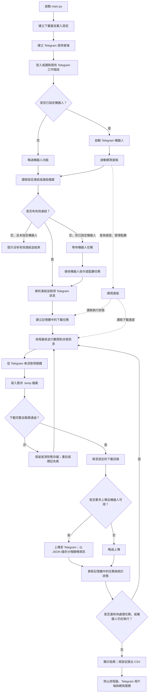
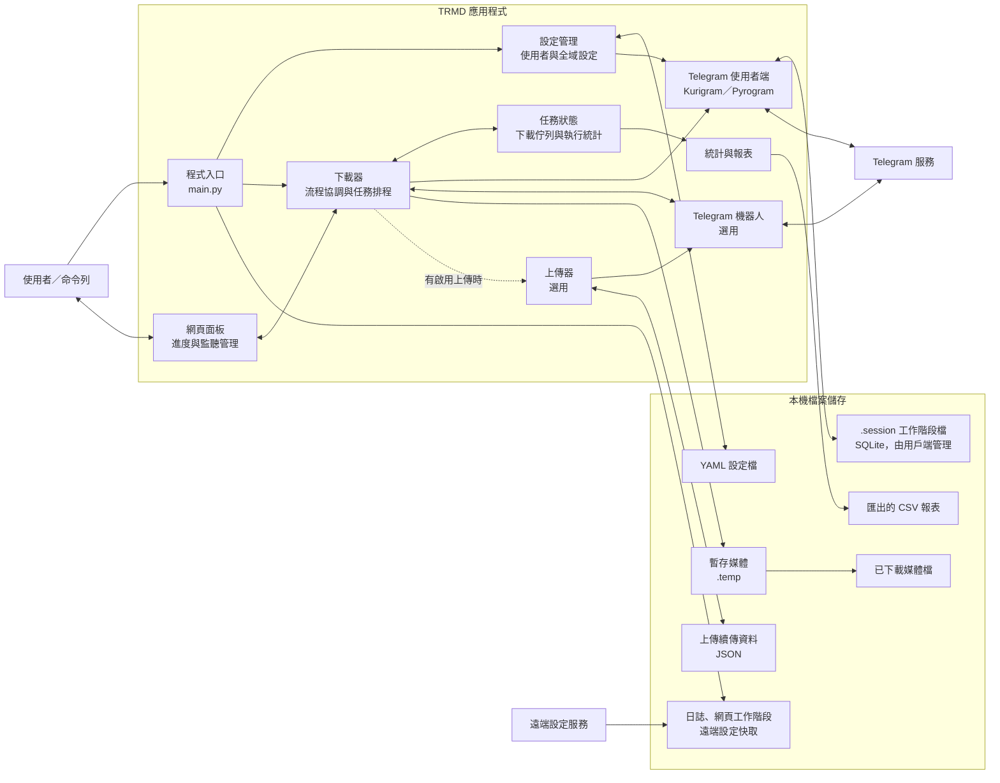

# 程式流程與元件架構

## 程式流程圖

## 元件圖

## 資料儲存概覽

| 資料 | 儲存位置／方式 | 用途 |
| --- | --- | --- |
| Telegram 使用者與機器人工作階段 | 工作階段目錄中的 `.session` 檔案；由 Kurigram／Pyrogram 用戶端管理，採 SQLite 格式 | 保存 Telegram 登入工作階段，以供後續重用 |
| 使用者與全域設定 | YAML 檔案 | 保存 API 參數、下載目錄、並行數、機器人及其他設定 |
| 下載任務與執行統計 | 記憶體 | 維護目前佇列、任務狀態、進度與統計；不會持久化為應用程式資料庫 |
| 下載內容 | 設定的下載目錄 | 保存已完成的媒體檔案 |
| 未完成的下載 | 暫存目錄中的 `.temp` 檔案 | 保存部分下載內容，以供續傳處理 |
| 上傳續傳狀態 | 暫存目錄中的 `<檔案 SHA-256>.json` 檔案 | 記錄上傳分塊資訊，以供上傳續傳 |
| 日誌、網頁工作階段權杖與遠端設定快取 | 本機檔案 | 記錄執行日誌、網頁工作階段狀態與遠端設定快取 |
| 統計報表 | 可選的 CSV 檔案 | 匯出下載、連結或上傳統計 |

**資料庫結論：**應用程式本身沒有用於下載任務、使用者或統計資訊的業務資料庫。SQLite 用於 Telegram 用戶端的工作階段儲存；應用程式的任務狀態主要保存在記憶體中，部分續傳狀態與設定則儲存在一般檔案中。
